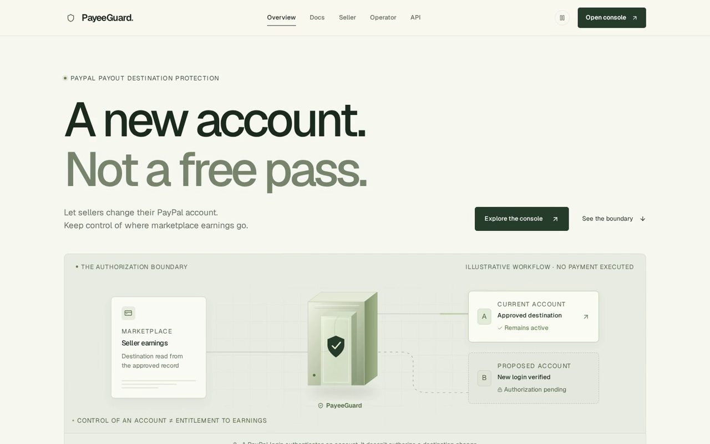
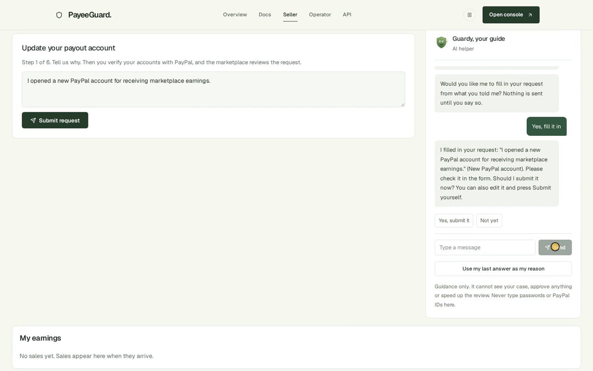
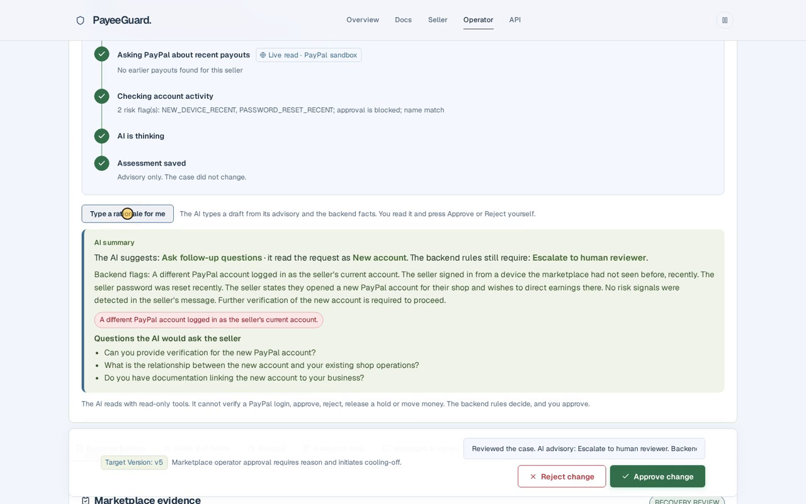
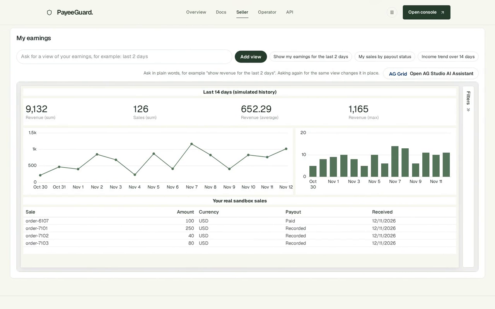
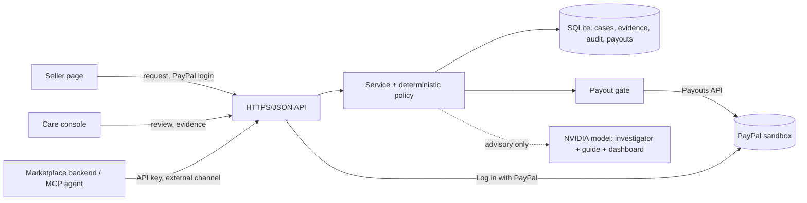

# PayeeGuard

### A login is not permission to redirect someone's earnings.

PayeeGuard is a marketplace-side authorization layer for one risky action: **changing the PayPal account a seller's earnings are paid to.**
**Rules decide. AI recommends. A person approves. Every payout still goes to the account the backend has on file.**

Built for the **PayPal AI Hackathon** (PayPal sandbox + AI).

| | |
|---|---|
| **Watch** | Demo video, under 3 minutes: https://youtu.be/zTndvYqMAP0 (local copy: [`docs/demo/payeeguard-demo.mp4`](docs/demo/payeeguard-demo.mp4), captions [`.srt`](docs/demo/payeeguard-demo.srt)) |
| **Hosted demo** | https://payeeguard.onrender.com (sandbox only; logins are in the Devpost *Testing instructions* field) |
| **Try it** | [Run it](#run-it-setup-and-run-instructions) (no keys needed for demo mode) or [judge testing instructions](docs/JUDGE_TESTING.md) |
| **Understand it** | [Why PayPal and AI](#why-paypal-and-ai) · [Why each sponsor tool mattered](#why-each-sponsor-tool-mattered) · [Architecture](docs/architecture.md) · [API](docs/openapi.yaml) |
| **License** | MIT, see [`LICENSE`](LICENSE) |

**In 30 seconds:** a seller wants to move payouts to a new PayPal account. PayeeGuard makes them prove *both* accounts with real *Log in with PayPal*, checks marketplace risk signals with fixed rules, lets an AI investigator read the case and recommend, and only then lets a human approve. A stolen login that tries the same thing is stopped by the rules, and the AI summary says why.

## The problem

Marketplaces pay sellers through PayPal. If someone takes over a seller's marketplace login, they can point every future payout to their own PayPal account. A "change payout account" form is an account-takeover target, and a seller who really did open a new PayPal account needs it to work.

## Why PayPal and AI

**Why PayPal.** The risk lives in the PayPal account, not in the marketplace form. Only PayPal can say whether someone really controls a given account (*Log in with PayPal* returns a payer ID, the verified flag, the name and the country), and only PayPal's Payouts API moves the money. Without PayPal there is no ground truth: we would be trusting what a seller types. With sandbox PayPal we can prove "this person controls account B" and "the account that logged in as the current one is not account A", and test the whole flow with no real money.

**Why AI.** The decision needs judgment on messy facts: the seller's own words, a risk feed, PayPal's answers, and a case history. The AI does the reading and explaining so a care person does not have to:
- the **investigator** reads the case with five read-only tools, asks PayPal about recent payouts and writes a recommendation and the questions it would ask the seller;
- **Guardy** helps a worried seller explain why they are changing accounts, and can fill the form after the seller says yes;
- the **dashboard assistant** turns "show risk flags for the last 4 days" into a chart.

**Why both, together.** Neither is enough alone. AI alone cannot be trusted with money, and a small model can miss facts (we saw it write "no risk signals" on a stolen-login case, so the backend now states trusted flags itself). PayPal alone gives facts but no explanation and no help for the seller. So PayPal supplies the *facts*, fixed rules make the *decision*, AI supplies the *reading and explanation*, and a person *approves*. The AI cannot approve, reject, verify a login or move money.

## Why each sponsor tool mattered

| Tool | What it made possible | Without it |
|---|---|---|
| **PayPal sandbox** (Log in with PayPal, Payouts) | Real proof of control of both accounts, real name and country checks, and real sandbox payouts through a gate that pays only the stored account | We could only simulate PayPal. The core claim, that a login is not entitlement, could not be shown on a real account |
| **NVIDIA hosted models** | One free API key for the investigator, Guardy and the dashboard assistant, with tool calling | Three separate model setups, or paid keys, which judges would have to configure |
| **AG Grid** | The operator queue and the append-only audit trail as fast, sortable grids | We would have hand-built tables, with less time left for the policy and the tests |
| **AG Studio** (45-day trial) | Both dashboards, a custom widget, and an AI Assistant chat that builds a chart from plain words | Hand-coded charts and no "ask for a chart" feature at all. Judges could not see how the AI helps a care team look at trends |
| **Postman CLI** | A repeatable 46-request, 62-assertion contract run against the real HTTP handlers | We would have relied on unit tests only and had no external check of the API contract |
| **APIMatic Context Plugin** | A review checklist for our hand-written PayPal client. It exposed one real gap: the app token was cached forever and would have failed after about nine hours. We fixed it and added a test | We would likely have shipped the token bug. The plugin covers the PayPal Server SDK, not our client or Log in with PayPal, so it was a review aid, not a dependency (see [`docs/APIMATIC_USE.md`](docs/APIMATIC_USE.md)) |
| **ElevenLabs** | The demo video's voiceover | A silent or hand-recorded video |

Render is planned for a hosted judge demo and is not claimed until it is deployed.

## Screenshots and architecture

| | |
|---|---|
|  |  |
|  |  |

Architecture diagrams: [`docs/architecture.md`](docs/architecture.md). API: [`docs/openapi.yaml`](docs/openapi.yaml) and the in-app API page.

## What PayeeGuard does

1. **The seller asks** to change the payout account (the help chat can draft the reason and, after the seller says yes, fill and submit the request).
2. **Both PayPal accounts are proven** with real *Log in with PayPal* (sandbox): the new one first, then the current one. A different account logging in as "current" is flagged.
3. **Rules decide.** A deterministic policy checks the evidence and marketplace risk signals (new device, password reset, country change, recent destination change, name and country match). Two risk flags block approval. One flag lengthens the safety wait.
4. **An AI investigator advises.** It opens with every case, reads the case with read-only tools and asks PayPal (sandbox) about recent payouts. It cannot approve, reject, verify or move money.
5. **The marketplace care team decides.** Approval needs recorded marketplace evidence. A clean change can take the **fast lane**, where the rules approve it with no human review; the safety wait still runs and the seller can cancel.
6. **A payout gate pays only the stored active payer ID.** While a change is pending, new sales still go to the current account. The audit trail is append-only.

Two sides, two looks: the **seller** page and the **marketplace care (operator)** console, each with its own AG Studio dashboard.



## PayPal and AI use (hackathon requirement)

| | What we use |
|---|---|
| **PayPal sandbox** | *Log in with PayPal* (identity, verified account, name and country) to prove both accounts. *Payouts API* (create, batch and item read, cancel semantics) for the payout gate. Sandbox only. No live environment is ever called. |
| **AI** | NVIDIA `nvidia/nemotron-3.5-bolt-e4b` through `langchain-nvidia-ai-endpoints`. Three separate uses: (1) the **investigator** with 5 read-only tools; (2) the **seller help chat** with no tools and no case data, which can draft a request for the seller to confirm; (3) a **dashboard assistant** on its own client, also used behind the **AG Studio Agent Framework** chat (`createAiHarness` + `directLlmRunner` with our own adapter): the model picks a view from a fixed menu and our code fills Studio's data mapping. Prompts, tool lists and evaluation results are in [`docs/AGENT.md`](docs/AGENT.md) and [`docs/EVALUATION.md`](docs/EVALUATION.md). |
| **Where AI stops** | It never approves, rejects, verifies a login or moves money. Deterministic code and a person do. The only thing the AI can submit is the seller's *own* request, after the seller confirms. |

## Tools, models and services

| Tool | How it is used | Status |
|---|---|---|
| PayPal sandbox (Log in with PayPal, Payouts) | Identity proof and payouts | Used, sandbox |
| NVIDIA API (`nemotron-3.5-bolt-e4b`) | Investigator, seller guide, dashboard assistant | Used |
| AG Grid Community | Operator queue and case audit trail | Used |
| AG Studio (45-day trial) | Operator and seller dashboards, a custom widget, Agent Framework adapter | Used, **needs a trial key to run** (see below) |
| Postman CLI | 46-request contract run, 62 assertions, 0 failed ([`docs/postman-run-2026-11-11.txt`](docs/postman-run-2026-11-11.txt)) | Used |
| APIMatic Context Plugin (PayPal) | Used to review our PayPal client; led to a fix ([`docs/APIMATIC_USE.md`](docs/APIMATIC_USE.md)). No SDK generated, no claim form. | Used as a review aid |
| ElevenLabs (Flash v2.5, free tier) | Synthetic narration in the demo video only | Video only |
| Render | Not used | Not claimed |

The project was written with AI coding assistants (Claude Code, Codex, Antigravity). Tests and the evaluation set are in the repository.

## What is real and what is simulated

- **Real:** PayPal sandbox logins and payouts, NVIDIA calls, the policy, the payout gate and the audit trail.
- **Simulated, and labelled in the UI:** marketplace security signals and entitlement (a feed we import), and the trend charts on the dashboards (14-day income, 7-day risk flags, 5-week request history). Deterministic blocking is not evidence that the model detected fraud.

## Run it (setup and run instructions)

### 1. What you need

- Linux or macOS, `git`, and [pixi](https://pixi.sh). Pixi installs Python 3.11 and Node 22 for you.
- Keys. **None are required for the quickest run.** Fill in more only if you want the live parts:

| Key (put in `.env`, see `.env.example`) | What it unlocks | Where to get it | Without it |
|---|---|---|---|
| `NVIDIA_API_KEY` | Live AI: the case investigator, the Guardy seller chat, the dashboard Ask box | Free key at [build.nvidia.com](https://build.nvidia.com) | Run with `--ai fixture` (canned AI answers) |
| `PAYPAL_CLIENT_ID`, `PAYPAL_CLIENT_SECRET` | Real PayPal **sandbox** logins and payouts | [developer.paypal.com](https://developer.paypal.com) > Apps & Credentials > Sandbox | Demo mode simulates PayPal |
| `VITE_AG_STUDIO_LICENSE` (in `ui/.env.local`) | AG Studio dashboards (commercial; free 45-day trial) | [ag-grid.com](https://www.ag-grid.com) | The dashboards area may not render (not verified). The rest of the app works. |

**One NVIDIA key covers every AI feature; models, speeds and which keys are needed are in [`docs/MODELS.md`](docs/MODELS.md).** The AG Studio AI Assistant chat and the Ask box use the small NVIDIA model through a fixed menu of views (fast, one key). Add `?studioTools=1` to a dashboard URL to use Studio's own tools through a stronger NVIDIA-hosted model (`RESCUE_STUDIO_MODEL`, `mistralai/mistral-large-4-1t-a52b` by default, same `NVIDIA_API_KEY`). That mode depends on free hosted endpoints that can be slow. Other optional settings: `RESCUE_DASHBOARD_MODEL` (the Ask box picker), `RESCUE_FAST_LANE=on`. All are listed in `.env.example`.

### 2. Install and build (once)

```sh
git clone <this repo> && cd <this repo>
pixi install
cd ui && npm ci
echo 'VITE_AG_STUDIO_LICENSE=<your trial key>' > .env.local     # optional, never commit it
NODE_OPTIONS=--max-old-space-size=6144 npm run build              # AG Studio needs the larger Node heap
cd ..
cp .env.example .env                                              # then fill in the keys you have
```

The built UI (`ui/dist`) is not stored in the repository, so the build step is required.

### 3. Run, pick one mode

**A. Quickest test: no accounts, no keys (simulated PayPal, canned AI)**

```sh
pixi run python -m rescue.destination_demo --directory /tmp/payeeguard-demo
pixi run python -m rescue.app serve --mode demo --ai fixture --runtime-dir /tmp/payeeguard-demo
```

Open `http://127.0.0.1:8765`. The seed refuses to overwrite an existing directory, so choose a new one each time. Log in with `creator` (the seller) or `operator` (the care team). The passwords are in `/tmp/payeeguard-demo/demo-accounts.json` (a private local file). This path was re-checked for this README: the seed, the server, and the `/`, `/console` and `/seller` pages all respond.

**B. Same, with the live NVIDIA model** (needs `NVIDIA_API_KEY`)

```sh
pixi run python -m rescue.app serve --mode demo --ai nvidia --runtime-dir /tmp/payeeguard-demo
```

PayPal is still simulated. Only the AI calls are real. This exact combination was not re-run when the README was written.

**C. Real PayPal sandbox and NVIDIA** (advanced; needs all keys)

You also need, in your PayPal sandbox: an app with *Log in with PayPal* enabled and the return URL `http://127.0.0.1:8765/api/v1/paypal/callback`, two personal sandbox accounts (the seller's current and new accounts), and a **funded business account** (payouts fail with `INSUFFICIENT_FUNDS` otherwise). Then create the database and the seller and operator grants with the provisioning commands in [`docs/BACKEND_SETUP.md`](docs/BACKEND_SETUP.md) (section "Sandbox destination workflow"), and start the server:

```sh
pixi run python -m rescue.app serve --mode sandbox --ai nvidia --runtime-dir <runtime dir>
```

Sandbox mode makes real calls to PayPal's sandbox. It refuses live credentials. All commands, with options, are in [`docs/COMMANDS.md`](docs/COMMANDS.md).

### Test access for judges

See [`docs/JUDGE_TESTING.md`](docs/JUDGE_TESTING.md). No password is stored in this repository. The four app logins and the three shared PayPal sandbox accounts are in the **Testing instructions** field on Devpost (private to judges).

- **Hosted demo:** sign in with the four logins from the Devpost field (`seller`, `operator`, `seller_stolen`, `operator_stolen`) and log in to PayPal with the shared sandbox accounts.
- **Local:** `pixi run judge-setup` generates the same four logins with fresh passwords on your machine, and `pixi run judge-serve` starts the app. Use the shared PayPal accounts. Or use mode A above, which needs no accounts at all.
- **PayPal accounts:** **A** is the seller's current (old) account, **B** is the seller's new account in the genuine case, and **T** is a fraudster's new account in the compromised-credentials case.

> The PayPal accounts are sandbox test accounts. No real money moves.

## Tests

```sh
pixi run test                                     # 263 Python tests + the UI DOM tests
cd ui && npx vitest run                           # 9 UI unit tests
pixi run python integrations/postman/run_destination.py   # Postman CLI contract run (needs the Postman CLI)
```

Evaluation of the investigator on a labelled set is in [`docs/EVALUATION.md`](docs/EVALUATION.md). Security and red-team notes are in [`docs/RED_TEAM.md`](docs/RED_TEAM.md) and [`docs/SECURITY_AUDIT_060_065.md`](docs/SECURITY_AUDIT_060_065.md).

## For a marketplace's own systems: API and MCP

- **REST API:** `/api/v1/*`, described in [`docs/openapi.yaml`](docs/openapi.yaml) (22 operations) and the Postman collection in `integrations/postman/`.
- **API keys:** `Authorization: Bearer pgk_...` for a marketplace backend. Only a digest is stored, keys are revocable, and a key works only for an `external`-channel grant. It can create, read and cancel its own seller's requests, never approve, review or run payouts.
- **MCP server:** `rescue/mcp_server.py` (stdio, five tools: list, read, create, cancel, start PayPal verification). No approve, reject or payout tool. A live round trip against the sandbox server was not run before submission; unit tests cover it.

## What changed in this existing project

The repository began as a PayPal sandbox probe (`rescue/experiments.py`, git history starts 2026-11-10). For the hackathon we built, on top of it: the destination-change policy and risk flags, the fast lane, the payout gate and append-only audit trail, the NVIDIA investigator, seller guide and dashboard assistant, the React seller and care consoles, the AG Studio dashboards, the REST API with keys, the MCP adapter, the Postman suite, the evaluation set, and the demo video. The earlier prototype's README is kept in [`docs/LEGACY_PAYOUT_RESCUE.md`](docs/LEGACY_PAYOUT_RESCUE.md).

## Limits

- Sandbox only. It refuses to run live PayPal credentials. This is a prototype, not a production payment system.
- Marketplace signals, entitlement records and trend charts are simulated.
- The AG Studio trial key expires on 2026-12-26 and is for evaluation only. A production build would need a paid licence.
- One server process per database.
- The MCP server and the marketplace API key path have unit tests but no live end-to-end run.

## Repository map

| Path | What it holds |
|---|---|
| `rescue/` | Python backend: API, policy, risk flags, payout gate, PayPal client, AI investigator, seller guide, dashboard assistant, MCP server |
| `ui/` | React + Vite + TypeScript app (seller page, care console, AG Grid, AG Studio dashboards) |
| `tests/` | 263 Python tests and the UI DOM tests |
| `integrations/` | Postman collection and runner, APIMatic notes |
| `docs/` | Decisions, evaluation, setup, OpenAPI, the demo video and script, the hackathon rules summary |
| `docs/archive/` | Older handoff notes, UI briefs and the original Payout Rescue drafts. Kept for history, not needed to run or judge the project |

More: [`AGENTS.md`](AGENTS.md) (scope and security boundaries), [`docs/DECISIONS.md`](docs/DECISIONS.md), [`docs/PROJECT_STATUS.md`](docs/PROJECT_STATUS.md), [`docs/DEVPOST_DESCRIPTION.md`](docs/DEVPOST_DESCRIPTION.md).
