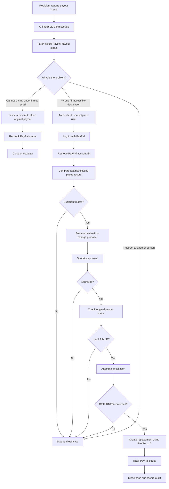

I read this as an independent agent's review of Payout Rescue. **I agree with its main conclusion: conditional GO, but with a significant change in positioning.**

This is better than the earlier generic payout-recovery pitch. The report identifies a more defensible product angle: **a payout destination should not be changed just because someone sends a message asking for it to be changed.** The recipient should authenticate the destination PayPal account, the marketplace should verify that it belongs to the intended payee, and the backend should enforce the recovery rules.

The report also correctly identifies that the standalone business opportunity is weakly evidenced and that the hackathon category is crowded. Pasted text(5)

## 1. What I agree with

### A. Stop leading with "stuck payouts"

That problem is real, but much of the basic remediation already exists.

PayPal's documentation says that an unclaimed payment can result from an incorrect recipient email, an unconfirmed email, or a recipient who has not received the notification. It already provides instructions to confirm an email, cancel an unclaimed payment, or resend to the correct details. [PayPal Developer](https://developer.paypal.com/payouts/faqs)

There are also existing products that automate pieces of this process:

- AffiliateWP documents automated emails to affiliates and daily retries after the affiliate resolves the issue. [AffiliateWP](https://affiliatewp.com/docs/paying-your-affiliates/?utm_source=chatgpt.com)
- Refersion tells merchants to contact the affiliate, wait for the funds to return, and retry the payment. [support.refersion.com](https://support.refersion.com/en/articles/4702111-understanding-payment-status)
- Tipalti supports additional two-factor authentication when payees change payment-method details. [Tipalti](https://help.tipalti.com/hc/en-us/articles/30607373030295-Two-factor-authentication)

So the product cannot credibly claim that nobody handles failed payouts or verifies payee changes.

The better gap is **making PayPal account authentication part of a recipient-driven destination change, connecting it to the marketplace's existing payee record, and safely coordinating the resulting payment operation.**

### B. PayPal identity is a stronger differentiator than generic payout status

This is the most important finding in the report.

PayPal's current Log in with PayPal reference explicitly says that the account-information scope can return:

- Account verification status.
- The user's PayPal account ID, or payer ID.
- An account ID described as usable in PayPal APIs such as Payouts. [PayPal Developer](https://developer.paypal.com/log-in/references/)

The Payouts API, in turn, defines `PAYPAL_ID` as the encrypted PayPal account number. [PayPal Developer](https://developer.paypal.com/api/payments.payouts-batch/v1/definitions/create_payout_request/)

That gives us a strong documented reason to test this integration. It is not just an invented idea to connect PayPal login with PayPal Payouts.

**One qualification:** the documentation makes the relationship credible, but the actual sandbox payout request is still the decisive test. Also, PayPal authentication establishes control of an account; it does not establish that the account holder is entitled to a marketplace payout.

### C. The sandbox cancellation risk is real enough to change the build plan

The report highlights cancellation failures reported by other builders. Disburse independently describes an internal server error when cancelling an unclaimed payout in sandbox. [Devpost - The home for hackathons](https://devpost.com/software/disburse-9o2r78?utm_source=chatgpt.com)

That is not proof that PayPal's cancellation API is generally broken. It is enough evidence to treat the operation as a major prototype risk.

The correct response is to test it immediately and design for failure:

- If cancellation succeeds, retrieve the item and confirm `RETURNED`.
- If cancellation times out or returns an error, retrieve the item again.
- If the original is still claimable, do not create a replacement.
- Keep the case in `CANCELLATION_PENDING` or escalate it.

PayPal's documentation confirms that cancellation is limited to unclaimed payments and that the cancellation endpoint's resulting transaction status is `RETURNED`. [PayPal Developer](https://developer.paypal.com/payouts/faqs)

---

## 2. Three corrections I would make to the report

The direction is right, but I would refine three technical and security claims.

### Correction 1: Do not treat every `UNCLAIMED` payout as the same problem

The Payouts status definition describes `UNCLAIMED` as a recipient without a PayPal account. However, PayPal's transaction-log reason codes also distinguish:

- `RECEIVER_UNREGISTERED`: the recipient does not have an account.
- `RECEIVER_UNCONFIRMED`: the recipient's email or phone is unconfirmed, and payments are marked `UNCLAIMED` until the recipient confirms their account information. [PayPal Developer](https://developer.paypal.com/payouts/use-payouts/view-transactions)

This matters because the agent should not recommend cancelling every unclaimed payment.

The decision should be:

| Situation | Correct action |
|---|---|
| Recipient has not registered | Help them create or access a PayPal account |
| Recipient's email is unconfirmed | Guide them to confirm it |
| Recipient can still access the original PayPal email/account | Help them claim the original payment |
| Original destination is wrong or inaccessible | Authenticate the intended recipient's new PayPal destination |
| Recipient wants to redirect money to someone else | Stop and escalate |

If PayPal does not provide a sufficiently specific reason code for an item, the application should say **"unclaimed — cause not yet identified"**, rather than guessing.

### Correction 2: PayPal login must not become your entitlement check

This is a critical security distinction.

Imagine the marketplace owes Alice \$100. Someone asks support to change the payout destination to their own PayPal account.

They can authenticate their own PayPal account successfully. That does not prove they are Alice.

Your system needs two separate checks:

1. **Marketplace-side identity:** Is this authenticated marketplace user the payee to whom the platform owes the money?
2. **PayPal-side destination:** Which PayPal account did that user authenticate?

The backend then compares the account information with the existing payee record and applies its verification policy.

The LLM must not decide that two people are the same person just because their names look similar.

### Correction 3: Do not overstate the novelty of destination-change security

Tipalti already provides two-factor authentication for payment-method changes and a workflow in which existing payee verification can be required before the change. [Tipalti](https://help.tipalti.com/hc/en-us/articles/30607373030295-Two-factor-authentication)

So the novelty is not simply "we verify payout destination changes."

Your more specific proposition is:

**A recipient authenticates a PayPal destination through PayPal itself; the marketplace checks that account against its existing payee record; and the payout workflow can use the PayPal account ID instead of relying on a newly typed email address.**

That is a much more precise differentiator.

I also would not cite the Assisted Account Creation statement about payer IDs being the most reliable method until the reviewer supplies the canonical current PayPal documentation URL. The current Log in with PayPal reference already provides a strong, independently verifiable basis for the payer-ID direction.

---

## 3. The revised product positioning

Keep the name **Payout Rescue** for the hackathon. Change the thesis.

# Payout Rescue
### Nobody can change where your payout goes just by asking.

Marketplaces pay creators, affiliates, and independent contributors through PayPal. When someone reports that a payout went to an old or incorrect email address, the platform needs to establish who is requesting the change and where the money should actually go.

A message or email is not sufficient proof.

Payout Rescue is an AI-assisted recipient verification and payout recovery system. It interprets the recipient's request, authenticates their intended PayPal destination through Log in with PayPal, compares the authenticated account with the marketplace's existing payee record, and prepares a safe recovery action for approval.

The marketplace retains control over entitlement and approval. Deterministic backend rules enforce PayPal transaction-state checks and prevent duplicate payments. Once an original unclaimed payout is confirmed returned, an approved replacement can be sent to the authenticated PayPal account ID.

The AI handles messy, multilingual, and potentially adversarial conversations. It does not decide who deserves the money or independently move funds.

**Core principle:** A payout destination cannot be changed by a message alone. The recipient must authenticate the destination, the marketplace must approve the change, and PayPal must confirm the original payment is safe to replace.

I would use this as the problem statement from now on.

---

## 4. Simplified task journey after the pivot

There are now three important paths.



The longer-term value is that the marketplace can save the authenticated PayPal destination for future payouts, subject to its own approval and account-update policy.

That gives the product value beyond resolving one support ticket.

---

## 5. The first four hours: the actual GO/NO-GO experiment

I agree with the report that the first few hours should determine whether to continue. Do not start Elastic, the full UI, or the agent framework yet. Pasted text(5)

Run these experiments in this order:

| Priority | Experiment | What constitutes a pass |
|---|---|---|
| 1 | Create a US Business sandbox sender and confirm Payouts access | A successful Payouts API request |
| 2 | Send a payout to an unregistered recipient | PayPal returns a real `UNCLAIMED` item |
| 3 | Test Log in with PayPal using the account-information scope | Obtain the sandbox payer ID and account verification status |
| 4 | Create a small payout using `recipient_type: PAYPAL_ID` and that authenticated account ID | PayPal accepts it and the item reaches `SUCCESS` |
| 5 | Cancel a separate unclaimed item through the API | Item becomes `RETURNED` |
| 6 | Try the dashboard cancellation route if the API call fails | Determine whether manual cancellation works in the sandbox |

The country constraint is confirmed by PayPal's current country table: India is listed as receive-and-withdraw, while the United States is fully localized. Use a US Business sandbox sender. [PayPal Developer](https://developer.paypal.com/payouts/supported-features/)

### The actual decision

- **Payer ID payout works + cancellation works:** build the full authenticated recovery flow.
- **Payer ID payout works + cancellation fails:** build the identity and destination-verification flow; demonstrate cancellation failure safely, and label any returned/replacement branch as simulated.
- **Payer ID payout fails + email-based authentication works:** fallback to an authenticated PayPal email destination, while being honest that the stronger account-ID differentiator is incomplete.
- **Both identity and payout integration fail:** do not spend the remaining time building a simulated version of the central promise.

The API's `sender_batch_id` duplicate protection is useful: PayPal rejects reuse of a batch ID from the preceding 30 days and supports safely retrying the same batch after a 5xx response. Still implement your own case-level duplicate prevention as well. [PayPal Developer](https://developer.paypal.com/api/payments.payouts-batch/v1/definitions/create_payout_request/)

---

## 6. Cut the project scope

I agree with the report's proposed reduction. The deadline makes broad sponsor integration a liability, not an advantage.

| Component | Decision |
|---|---|
| PayPal Payouts API | Essential |
| PayPal Log in with PayPal | Essential |
| PayPal webhooks | Essential if reliable; otherwise use polling as a backup |
| AI agent with constrained tools | Essential |
| Deterministic policy/state machine | Essential |
| Two-pane chat and operator UI | Essential |
| Append-only audit log | Essential |
| Render | Use for hosting if straightforward |
| AG Grid | Optional; skip the sponsor chase |
| Elastic | Drop |
| Postman | Useful for testing, not a product feature |
| APIMatic / Zapier | Drop |

PayPal's item-level webhook events include `UNCLAIMED`, `RETURNED`, and other payout events. Batch-level events do not include item-related information, so the application must retrieve item details through the HATEOAS links. [PayPal Developer](https://developer.paypal.com/payouts/webhooks/)

### The five agent tools

Keep the agent restricted to:

```text
get_payout_status()
get_payee_record()
request_paypal_authentication()
compare_payee_evidence()
propose_action()
```

**Do not expose cancellation and replacement creation as LLM-callable tools.**

The operator should approve the proposed action, and the backend should independently validate the transaction state and policy before calling PayPal.

This is a strong architectural decision from the report. Pasted text(5)

---

## 7. What should the demo prove?

The demo should tell one coherent story, not show a collection of API calls.

**Scene 1 — The recipient's problem.** A creator says, "My old email is no longer accessible. You sent my payout there."

**Scene 2 — The agent investigates.** It understands the message, checks the actual PayPal item, identifies that the payment is unclaimed, and asks the recipient to authenticate their new PayPal destination.

**Scene 3 — Identity and destination.** The PayPal account ID is retrieved and compared with the marketplace's established payee record. The operator sees the evidence and approves or rejects the change.

**Scene 4 — Safe payout handling.** The system attempts cancellation. If PayPal confirms `RETURNED`, it creates the approved replacement using the authenticated PayPal account ID. If cancellation fails, it refuses to resend.

**Scene 5 — The adversarial request.** Someone says, "Send this to my friend's PayPal account instead. It's urgent." The agent identifies the discrepancy, refuses to proceed, and escalates.

The AI should demonstrate different reasoning and information-gathering paths, not just classify three sentences. The report is right to emphasize messy, multilingual, and adversarial conversations. Pasted text(5)

For impact, collect your own metrics: percentage of adversarial redirection requests blocked, percentage of cases with sufficient payee evidence, time to prepare a recovery decision, and number of unsafe replacement attempts prevented. Do not invent industry-wide percentages.

---

## 8. Source links I independently checked

These are the most useful primary links for the implementation and judge review:

| Source | What it verifies |
|---|---|
| [PayPal Payouts FAQs](https://developer.paypal.com/payouts/faqs) | Unclaimed payments, incorrect addresses, unconfirmed email, cancellation |
| [PayPal transaction status definitions](https://developer.paypal.com/api/payments.payouts-batch/v1/definitions/transaction_enum/) | `UNCLAIMED`, `RETURNED`, `SUCCESS`, and cancellation result |
| [PayPal transaction logs and error codes](https://developer.paypal.com/payouts/use-payouts/view-transactions) | `RECEIVER_UNREGISTERED` versus `RECEIVER_UNCONFIRMED` |
| [Log in with PayPal scopes](https://developer.paypal.com/log-in/references/) | Payer ID and account-verification scope |
| [Payouts create request schema](https://developer.paypal.com/api/payments.payouts-batch/v1/definitions/create_payout_request/) | `PAYPAL_ID`, recipient types, `sender_batch_id` |
| [PayPal Payouts webhooks](https://developer.paypal.com/payouts/webhooks/) | Item-level events and HATEOAS requirements |
| [PayPal supported countries](https://developer.paypal.com/payouts/supported-features/) | India and US sending eligibility |
| [Tipalti two-factor authentication](https://help.tipalti.com/hc/en-us/articles/30607373030295-Two-factor-authentication) | Existing secure payee-detail changes |
| [AffiliateWP payout handling](https://affiliatewp.com/docs/paying-your-affiliates/) | Existing auto-email and auto-retry handling |
| [Refersion payment status](https://support.refersion.com/en/articles/4702111-understanding-payment-status) | Existing unclaimed payout remediation |
| [Disburse hackathon submission](https://devpost.com/software/disburse-9o2r78) | Direct hackathon overlap and reported sandbox cancellation issue |

---

## My final decision

**Conditional GO — with the revised thesis.**

The report is persuasive enough that I would stop spending time on broad market research and generic judge reviews. The remaining uncertainty is mostly technical, and it can be settled by sandbox experiments.

The most important distinction is:

- **Old idea:** AI helps merchants resolve unclaimed payouts.
- **New idea:** AI handles the messy human request, but the destination is established through PayPal account authentication, matched to the marketplace's existing payee, and changed only through a controlled recovery process.

The latter has stronger PayPal centrality, a more defensible security story, and a clearer AI role. The risk is that the category is still competitive and the full recovery flow depends on sandbox behavior that other builders have reported as unreliable.

**My recommendation: spend the next four hours proving payer-ID payout creation and cancellation. Do not build the rest until those tests tell you which version of Payout Rescue is actually demonstrable.**