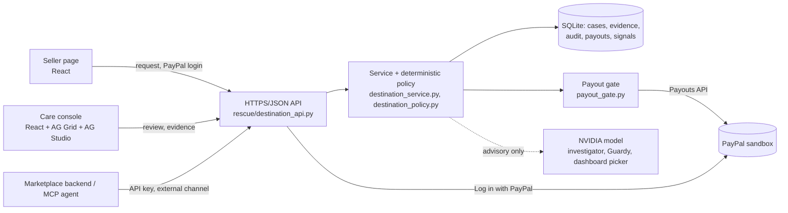
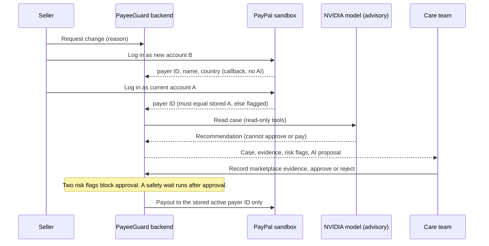

# PayeeGuard architecture

PayeeGuard is a marketplace-side authorization layer for changes to a seller's PayPal payout destination. **Rules decide, AI recommends, a person approves, and the payout gate pays only the stored active payer ID.**

## Components

## Change of payout account

## Where each guarantee lives

| Guarantee | Where |
|---|---|
| AI never approves, rejects, verifies or moves money | `rescue/investigator.py` (5 read-only tools); the page, not the model, submits the seller's own request |
| New-account login is not authorization | `rescue/destination_policy.py`, `rescue/destination_service.py` |
| Payouts use only the stored active payer ID | `rescue/payout_gate.py` |
| Append-only audit trail | `rescue/destination_store.py` events |
| Marketplace API keys and MCP cannot approve or pay | `rescue/store.py` (external channel), `rescue/mcp_server.py` |
| Credentials are never regenerated on deploy | `deploy/start.py`, `rescue/judge_setup.py` |

More: [`docs/DECISIONS.md`](DECISIONS.md), [`docs/openapi.yaml`](openapi.yaml), [`docs/docs/STATE_MACHINE.md`](docs/STATE_MACHINE.md).
